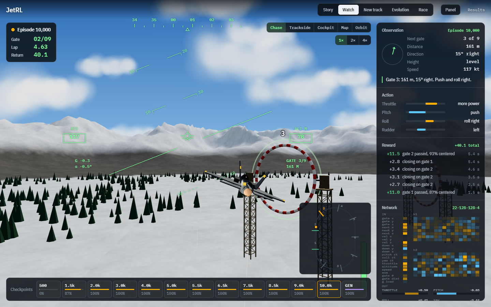
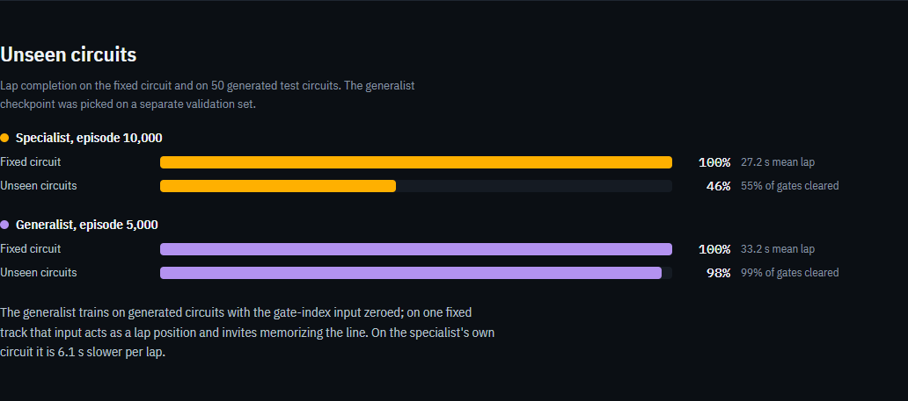
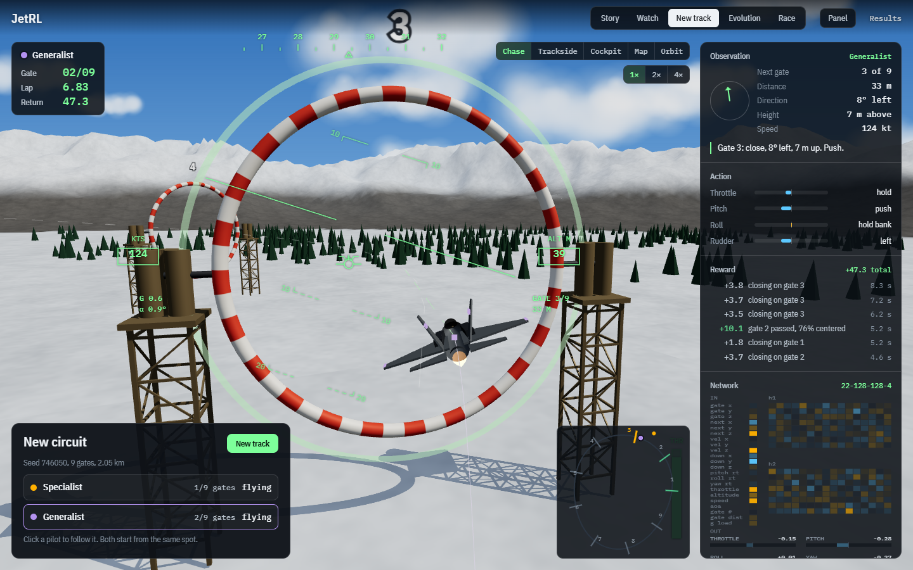

# JetRL

A PPO policy flies a jet through ring gates. One policy trained on a single circuit memorises it and fails on new ones; a second, trained on generated circuits, flies 98% of circuits it has never seen. Both networks run live in the browser on a TypeScript port of the simulator, checked step by step against the Python environment.



[GUIDE.md](GUIDE.md) explains the whole project in depth: the flight model, reward, PPO setup, evaluation protocol, and the questions to expect.

## Results

| | Fixed circuit (30 starts) | 50 unseen test circuits |
| --- | --- | --- |
| Specialist, episode 10,000 | 100% laps, 27.2 s | 46% laps, 55% of gates |
| Generalist, episode 5,000 | 100% laps, 33.2 s | **98% laps** (49/50) |
| Hand-written pilot (`test_env.py`) | 100% laps, 39.3 s | – |

The specialist sees which gate is next as an input, and on one fixed track that number tells it where it is on the lap. It learned the track, not how to fly to a gate. The generalist trains on circuits from `track.random_track()` with that input zeroed. Its checkpoint was chosen on 30 validation circuits (seed 777000) and reported on 50 separate test circuits (seed 888000). The browser port agrees: on 120 browser-generated tracks it laps 118, the specialist 60.



### Ablation

Each configuration was trained from scratch with the same settings for 4M steps. All of them learned to lap every start, so the comparison is how many steps that took:

| Configuration | Steps to 100% laps |
| --- | --- |
| Stall limit + random-gate starts (seeds 7 / 21 / 33) | 1.45M / 1.31M / 1.37M |
| No stall limit | 1.12M |
| No random-gate starts | 1.76M |

Neither fix is necessary with this flight model. Dropping random-gate starts was slowest, but with one seed that is a hint, not a finding.

## The site

`web/` is a static site. Everything on it is computed live from the exported networks, and every reported number comes from Python.

- **Story:** early training, first laps, the specialist, the specialist failing a new circuit, the generalist flying it.
- **Watch:** any checkpoint on the fixed circuit, with a panel showing the observation, the four actions, the rewards earned and the live network activations.
- **New track:** generate a circuit and watch both policies fly it, with a running tally.
- **Evolution:** every checkpoint at once from the same start.
- **Race:** fly against the policy with a keyboard or gamepad. Assist mode holds a bank angle while you steer and levels out when you let go.



`parity.test.ts` replays a Python-recorded episode: the TypeScript state must match every step to 10⁻⁹ m and the network's actions must match PyTorch to 10⁻⁴.

## Flight model

The jet is a point mass flying along its velocity, at 30 Hz.

- **Stick:** a centred pitch stick holds the flight path, and pulling adds load factor.
- **Turning:** banking tilts the lift, which turns the jet.
- **Stall:** the available lift drops with speed, so a slow jet stalls and sinks.
- **Drag:** hard turns bleed speed.
- **Attitude:** the nose sits along the velocity plus the angle of attack, so it always looks like it's flying where it's going.

## Run

```bash
python -m venv .venv
.venv\Scripts\activate           # Windows; source .venv/bin/activate elsewhere
pip install -r requirements.txt
python test_env.py               # environment checks and the hand-written pilot

python train.py --yes --episodes 10000 --checkpoint-every 500
python train.py --yes --timesteps 10000000 --episodes 1000000 --random-tracks 0.8 \
    --mask-gate-index --run-dir runs/generalist --checkpoint-every 1000
python eval_unseen.py runs/generalist/checkpoints --mask        # validation
python eval_unseen.py runs/generalist/checkpoints --only ep_05000 --mask \
    --track-seed 888000 --tracks 50 --fixed 30 --workers 1 --out runs/generalist/test_ep05000.json
python eval_unseen.py checkpoints --only ep_10000 --track-seed 888000 --tracks 50 \
    --workers 1 --out runs/specialist_test.json
python eval_ablation.py          # needs the runs/abl_* directories
python export_web.py             # writes web/public/data and the parity fixture

cd web
npm install
npm run dev                      # http://127.0.0.1:5174
```

`--dummy` runs the environments in one process, which uses much less memory. Each training run took about an hour on CPU.

## Deploy

`render.yaml` is a Render Blueprint for a static site: **New → Blueprint**, pick the repo. Render runs `npm ci && npm test && npm run build` in `web/` and serves `web/dist`.

## Code

```text
jet_env.py          Gymnasium environment: flight model, gates, reward
track.py            Fixed circuit and random circuit generator
train.py            PPO training and checkpoints
eval_unseen.py      Validation and test evaluation on generated circuits
eval_ablation.py    Ablation table
export_web.py       Evaluation and data export for the site
web/src/sim/        TypeScript simulator, policy, track generator, parity test
web/src/scene/      three.js airfield, jet, gates, cameras
web/src/hud/        Head-up display
web/src/ui/         Side panel, minimap, charts
```

## Limits

The flight model is a point mass, not a 6-DOF aircraft. Ablation configurations other than the full setup have one seed each, and the generalist was trained once.
